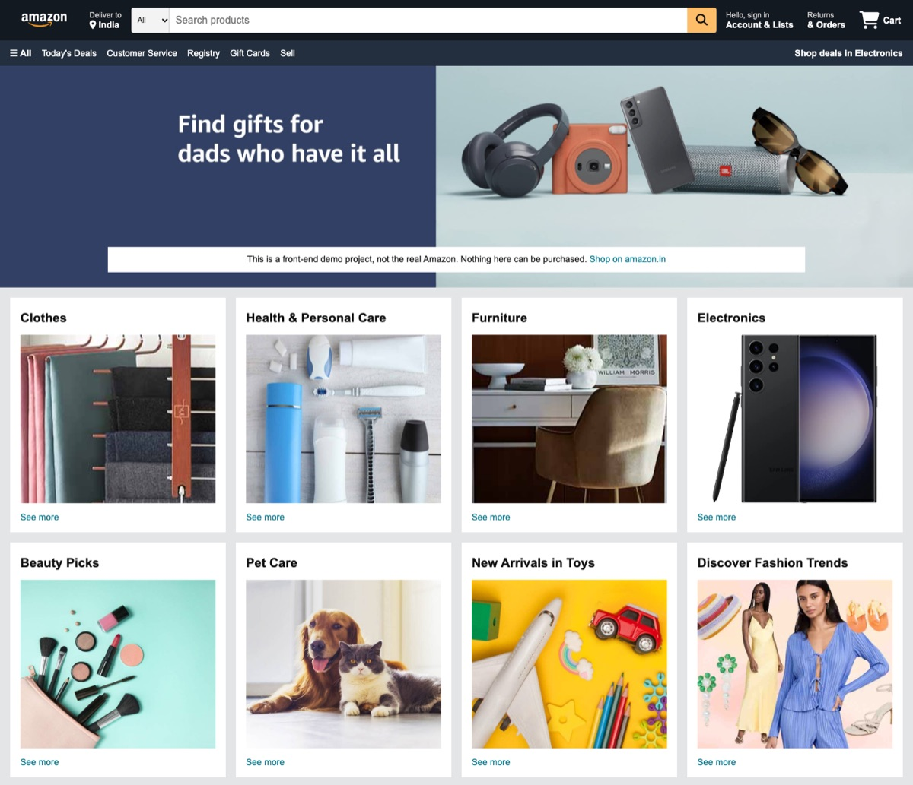

# Amazon Homepage Clone

A responsive clone of the Amazon homepage, built with plain HTML and CSS. No frameworks and no build step.

**Live demo:** https://rks0024.github.io/AMAZON_CLONE/



> This is an educational front-end project. It is not affiliated with or endorsed by Amazon.com, Inc., and nothing on the page can be purchased. It has no sign-in, checkout or data collection.

## Features

- Navigation bar with search, account, orders and cart
- Department panel, hero banner and an eight-card category grid
- Four-column footer with a working Back to Top link
- Responsive layout, tested from 320px phones to 1440px desktops
- Semantic HTML, image alt text, ARIA labels and visible keyboard focus

## Tech stack

- HTML5
- CSS3 (Flexbox, Grid, custom properties, media queries)
- [Font Awesome 6](https://fontawesome.com/) icons, loaded from a CDN

## Project structure

```
.
├── index.html
├── css/
│   └── style.css
├── assets/
│   ├── favicon.svg
│   └── images/
└── docs/
    └── screenshot.jpg
```

## Run locally

Clone the repository and open `index.html` in a browser:

```bash
git clone https://github.com/rks0024/AMAZON_CLONE.git
cd AMAZON_CLONE
open index.html   # macOS; on Windows use: start index.html
```

## Limitations

This is a static page. Links other than Back to Top and the amazon.in link are placeholders, and the search box does not run a search.

## Credits

The Amazon name and logo are trademarks of Amazon.com, Inc. Product and banner images belong to their respective owners and are used here for learning purposes only.
